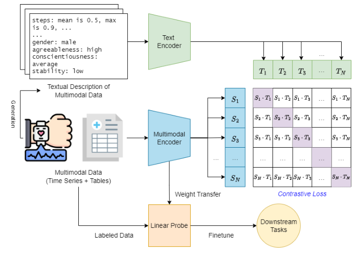
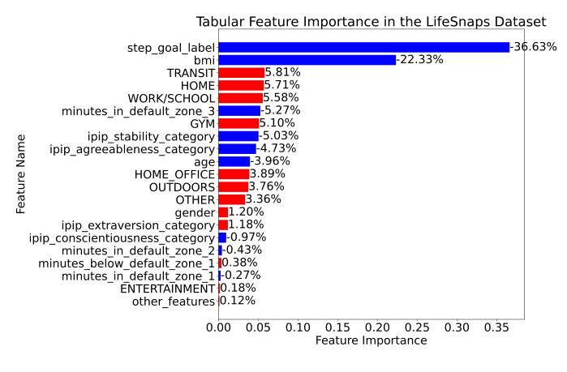
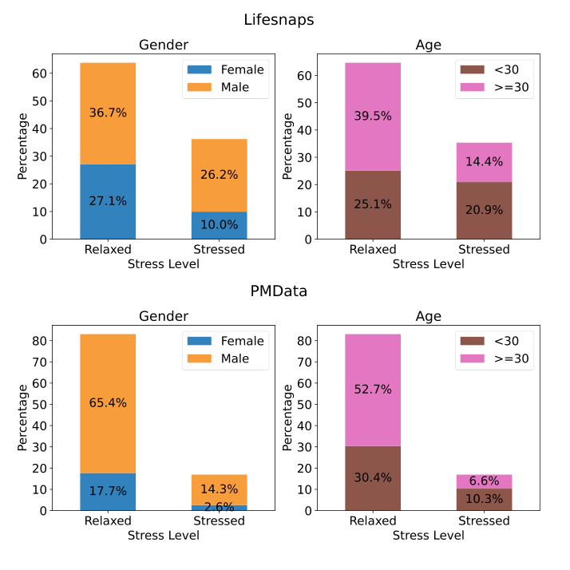

# 多模态压力检测复现：项目报告与视频制作依据

作者：Xiangwen Wang、Qichang Liu · CS598 Deep Learning for Healthcare · 整理日期：2026-11-26

这份报告供队友理解整个项目并制作4–7分钟视频。它将研究动机、模型、PyHealth实现、实验设计、实际结果与局限放在同一条叙述中。文中的实验是已有实跑结果，本次编写报告没有重新训练。课程不要求单独的final report；这份材料是组内协作用途。

**项目结论：我们完成了LifeSnaps的Dataset、Task、Model和完整训练流程，并执行了proposal计划的日历context干预、文本机制对照和同人/跨人AUC分析。但在当前实验协议下，没有建立稳定的CLSP预训练优势，也没有建立更好的旧context鲁棒性。** 实验完成与假设得到支持是两回事。

## 1. 我们要解决什么问题

可穿戴设备每天产生步数、心率等记录，但每天让参与者填写压力问卷成本较高，因此压力标签相对稀少。问题是：能否先利用大量无标签记录学到有用表示，再用少量有标签日期训练压力分类器？

我们复现的论文是Yang、Yu、Sano的 **Contrastive Pretraining for Stress Detection with Multimodal Wearable Sensor Data and Surveys**，发表于CHIL 2025。研究同时使用随时间变化的传感器数据和表格型背景信息。后者包括人口学、人格、活动和场所等字段，并不全部是压力问卷答案。[论文及作者信息](https://proceedings.mlr.press/v287/yang25a.html)

本项目的预测单位是“一个人一天”。LifeSnaps输入为五个传感器通道的24小时序列，以及22维context；目标是当天STAI类别转换的二分类：Above average为1，Average或Below average为0。压力标签和由标签生成的字段不能进入输入。我们研究的是当天压力分类，而非预测未来几天压力，也不是经过临床验证的诊断工具。

LifeSnaps是PyHealth贡献的主数据集：71名参与者、5,850个完整日期、228个有标签日期；有标签日期来自其中50人。PMData用于另一套独立复现，传感器和context组成不同；当前没有贡献PMData的PyHealth Dataset/Task，也没有进行跨数据集训练后迁移测试。

## 2. 论文方法：同一天数据的两个视图



图源：Yang、Yu、Sano，2025，原论文Figure 1，PDF第3页。这里保留作者图示；不是本组新实验结果。图像从本地论文PDF裁出图形区域，未更改图内数值或结构。

第一条分支处理数值输入：传感器Transformer提取小时序列表示，残差网络编码tabular context，两者拼接、融合并投影。第二条分支把同一天的传感器统计量和context写成结构化文字，用冻结BERT得到文字表示，再进行投影。对比学习让两条分支形成相互对应的表示。

例如，一个日期既有数值形式的心率序列和活动信息，也可描述为“heart rate mean …; activity …”。文字来自同一批原始信息，与数值输入有重合；它不是额外收集的临床报告。我们使用允许字段构建文字，不把压力标签写进去。这是CLIP风格的训练思路，并非直接调用图像CLIP预测压力。

预训练后，先冻结表示模型、只训练分类头（linear probing），再微调模型进行压力分类。BERT只服务于预训练的文字视图；下游分类推理使用sensor/context分支即可。

论文的核心假设是：文字引导的无标签多模态预训练能够改善下游压力分类。论文Table 1报告的AUC百分比如下。这些是作者结果，不能当作本组实测值：

| 数据集 | 作者Supervised | 作者CLSP |
|---|---|---|
| LifeSnaps | 67.18 ± 7.65 | 72.45 ± 4.70 |
| PMData | 80.81 ± 1.62 | 81.14 ± 1.79 |

作者CLSP相对该监督基线的均值差分别为5.27和0.33个百分点；这不等于在所有基线上都最优。我们的比较还需区分概率AUC与硬预测AUC，尤其PMData的论文指标口径仍有待进一步核对。

## 3. 我们实现了什么：从原始记录到预测

完整流程是：原始CSV → LifeSnapsDataset → StressDetectionLifeSnaps → 样本划分与预处理 → WearableStressModel → 训练及评估。

Dataset负责读取和整理记录：按人和日期组织小时数据，去掉重复小时，保留原顺序为0到23的完整小时日期，对已有小时行里的传感器缺失值插值并补齐；只有23小时的日期则排除。缺小时记录和某个小时内数值缺失是两种不同情况。缺失压力标签保留为无标签，未知非空标签类别报错。YAML告诉BaseDataset怎样把处理后的CSV加载成事件。

Task负责定义样本：从一个人的记录中构造每天的5×24传感器输入、22维context和二分类标签。监督任务只产生完整且有标签的日期；预训练任务也接受完整无标签日，而且不提供压力输出。Task还支持模态选择与历史观测配置。

Model负责计算表示、预测和loss。我们实现了PyHealth BaseModel接口、sensor/context编码器、融合、对比目标、分类头、预训练/探测/微调阶段以及保存恢复。训练example负责参与者划分、只用训练数据拟合预处理、真实文字/BERT表示、优化和评价。

| 核心代码 | 职责 |
|---|---|
| [Dataset](../pyhealth/datasets/lifesnaps.py) | 原始数据准备、完整日与标签处理、父类加载接入 |
| [Task](../pyhealth/tasks/stress_detection_lifesnaps.py) | 样本、特征、标签、无标签模式和配置 |
| [Model](../pyhealth/models/wearable_stress.py) | 编码器、损失、训练阶段及checkpoint |
| [完整训练example](../examples/wearable/lifesnaps_stressdetection_wearable_stress.py) | BERT配对、训练、评估、目标/文字/日历实验 |
| [MLP example](../examples/wearable/lifesnaps_stressdetection_mlp.py) | 现有PyHealth MLP的特征和task配置消融 |
| [分析入口](../examples/wearable/lifesnaps_stressdetection_analysis.py) | 汇总AUC、配对bootstrap、同人/跨人分解 |

一个实际纠错是soft target的梯度：初始实现截断了目标分布的梯度，而参考代码允许梯度流过。我们已将默认改为reference，保留stop_gradient和one_hot作为明确对照，并补充loss与梯度公式测试。早期偏差不是事后可以宣称的“原计划创新”。修正这处目标也不意味着其他架构、编码、预处理和训练协议全部与作者相同。作者代码曾作为行为参考，算法贡献归作者。

## 4. 两套实验协议：为什么结果不能混在一起比较

我们有两条实验线。独立repro追踪两数据集的论文复现；PyHealth example验证库内完整流程、受试者留出和新增消融。两条线回答的问题不同。

| 项目 | 独立研究复现 | PyHealth CLSP pilot |
|---|---|---|
| 数据集 | LifeSnaps、PMData各自训练测试 | LifeSnaps |
| 划分 | participant-day五折；同一人可跨训练/测试；少于5个标签日的人固定进训练 | 参与者级60/20/20；测试参与者不进入训练 |
| 新reference训练数 | 每数据集5折×4seed，共40次 | 目标模式9次＋额外文本控制6次，共15次CLSP训练 |
| CLSP预算 | pretrain300 / probe150 / fine-tune150 epochs | 每seed选256训练日；pretrain30 / probe10 / fine-tune20 |
| 选模型方式 | 固定最终epoch | 分类阶段validation probability AUC |
| 主要目的 | 在明确的本地协议下比较监督与CLSP | 可复用流程和有控制的机制/鲁棒性实验 |

独立复现修正目标梯度后，概率ROC-AUC结果如下。±是20个fold/seed结果的总体SD，不是置信区间，也不是20个人群独立验证：

| 数据集 | Supervised | 修正后的Reference CLSP |
|---|---|---|
| LifeSnaps | 74.37 ± 7.06 | 73.84 ± 6.95 |
| PMData | 73.98 ± 2.49 | 71.74 ± 2.98 |

40次CLSP是修正后的新训练，监督基线复用了原匹配记录，没有把它们说成新跑。我们实现并运行了复现，但没有建立作者报告的相对收益。预处理、context重建、split和训练选择等是可能影响因素；没有证据把差异完全归因于某一个因素。历史重复行实验和test-max超参选择属于诊断，不能当作无偏最终成绩。

PyHealth CLSP实验使用seed0/1/2，Adam lr0.001、batch512、dropout0.1，监督分支30epochs。只有训练参与者拟合预处理并进入预训练。测试集分别为37/46/39个有标签日、9/10/9名有标签参与者，规模较小。不同seed同时改变划分和初始化，SD包含两者的变化。

## 5. 消融一：旧context会不会让模型失效

### 为什么值得做

部署时传感器可能持续记录，但context可能没有及时更新。我们想检验两件事：旧context是否使AUC下降，以及CLSP是否比从头监督训练下降得更少。这个问题比单纯看同日测试分数更接近输入更新不及时的使用条件。



图源：原论文Figure 4，PDF第8页。这张图说明作者分析了context特征，但作者的特征置零分析不等于我们的日历时间干预，也不能直接证明旧context的影响。图中结果属于作者。

### 具体怎样操作

先分别训练同日输入的监督模型与CLSP模型，选好checkpoint。随后固定模型参数，对同一批测试日期分别设置k=0、1、3、7日。

对于待预测日期t，只从同一人的历史记录中找日期不晚于t−k的最近一条，把其中的动态context替换到当前日期。年龄、性别、BMI、人格字段在本实现中视为static，保留当前值；活动/场所、心率区间分钟数等动态字段被替换。传感器、标签、测试样本和模型权重都不变，预处理也不重新拟合。

举一个示意例子：预测6月10日，k=3时截止日期为6月7日。如果这个人只有6月4日和6月9日的历史context，就使用6月4日，不能选6月9日，也不能选另一个人的6月7日。实际使用的信息可能比3天更旧，因此k是截止规则，不保证每条记录恰好旧k天。这也不是删除部分问卷、重新模拟完整收集日程。

如果没有合格历史，用训练分区得到的逐坐标中位数作为预先规定的fallback，且只替换动态字段。当前真实实验全部fallback计数为0；合成测试专门检查历史不足时的行为。这不证明其他部署数据也不会需要fallback。

### 实际结果

以下单位均为概率ROC-AUC%，±是三seed总体SD：

| 模型 | 同日k=0 | k=1日 | k=3日 | k=7日 |
|---|---|---|---|---|
| Supervised | 52.83 ± 3.51 | 56.31 ± 2.67 | 57.47 ± 2.48 | 50.00 ± 6.04 |
| Reference CLSP | 50.03 ± 7.65 | 58.95 ± 8.08 | 51.99 ± 9.85 | 51.44 ± 10.18 |

为了判断“谁更抗过期”，需要比较相对各自同日基线的变化：

```
Drop(model, k) = AUC(model, 0) - AUC(model, k)
Difference(k) = Drop(CLSP, k) - Drop(Supervised, k)
```

Drop为正表示变差，为负表示改善；Difference为负才倾向支持CLSP下降更少。但一个均值差不足以下结论，还需要不确定性区间。

### 为什么做配对participant bootstrap

同一个人的不同日期不是互相独立的。我们以参与者为单位有放回抽样，并保留每次抽中者的全部测试日期；两模型、两个延迟条件使用完全相同的抽样，计算下降差。每个seed请求2,000次抽样，再取2.5%和97.5%分位数。seed1有14次只有一个标签类别，无法计算AUC，排除并记录；另外两个seed各2,000次有效。

| Seed | 7日CLSP减监督的下降差（百分点） | 配对bootstrap 95%区间（百分点） |
|---|---|---|
| 0 | -11.54 | [-30.94, +1.76] |
| 1 | -2.08 | [-41.29, +42.50] |
| 2 | +0.86 | [-9.85, +13.17] |

k=1、3、7的下降差区间全部包含0。性能也没有稳定地随k增加而下降。因此当前结果既不支持“context越旧一定越差”，也不建立“CLSP更抗过期”的优势；不显著也不等于两方法等效。区间基于固定模型和固定split，不包含重新训练的不确定性，三个有重叠参与者的split没有被合并成独立人群。

**视频可说：We tested deployment-time context staleness with fixed checkpoints, but did not establish a consistent robustness advantage for CLSP.**

## 6. 消融二：BERT的预训练知识到底带来什么

### 为什么值得做

文字来自已有的传感器统计和context，本身没有增加新的测量。因此即使CLSP有效，也不能直接认定是语言知识带来的。可能只是多了另一种数据表示和对比学习约束。我们用机制对照检验这点。

### 具体怎样操作

| 文字侧变体 | 改变什么 | 如何保持比较尽量一致 |
|---|---|---|
| Pretrained frozen BERT | 使用预训练语言模型表示 | BERT冻结；学习后续投影和多模态模型 |
| Random frozen BERT | 用同架构、同tokenizer，但全部权重随机初始化后冻结的BERT | 相同文字、编码维度、样本和训练协议；不是随机生成embedding向量 |
| Statistics projection | 不用BERT，直接输入55个sensor统计量＋22个context数值 | 仅训练子集拟合标准化；77维补零至768维以复用投影接口 |

三种变体都使用reference对比目标。同一个seed下保持参与者划分、选中的256个预训练日、传感器/context分支及训练预算一致。每个变体重新执行预训练→probe→fine-tune；不像日历实验只重新评估固定模型。随机BERT编码器seed固定为20261125，单独缓存，避免误读预训练BERT缓存。

### 实际结果与可解释范围

| 预训练文字侧 | 同日概率AUC%，三seed均值±SD |
|---|---|
| 预训练冻结 BERT | 50.03 ± 7.65 |
| 随机初始化冻结 BERT | 52.50 ± 19.80 |
| 统计量直接投影 | 45.13 ± 8.82 |

预训练BERT没有稳定胜过随机冻结BERT，随机变体的波动尤其大，因此没有建立可靠的预训练语言知识优势。统计投影均值较低，但它同时改变了类别表达和标准化，不能把差异全解释为“去掉语义”。也不能据此宣称BERT毫无作用；这里只覆盖小数据、固定预算、三个split/seed和当前适配实现。

文本机制矩阵是3种变体×3seed，其中3个pretrained/reference结果与目标函数实验共用，实际只新增6次训练，不能重复计算为新的9次。

**视频可说：Pretrained BERT did not show a stable advantage over a random frozen encoder in this small pilot; the statistical control also changes representation and scaling.**

## 7. 诊断分析：模型是在区分人，还是在跟踪同一个人的变化

### 为什么值得做

总体AUC基于高压力和低压力样本的分数排序。比较可以发生在不同人之间，也可以发生在同一个人的不同日期之间。一个模型即使主要学到了“哪些人通常分数较高”，总体AUC也可能不错，但这还不足以说明它能识别某个人压力升高的那一天。



图源：原论文Figure 8，PDF第9页。这是作者的人口学分布分析，提示我们关注个体差异；它不是我们AUC分解的结果，也不能当作因果偏差证据。我们自己的分析如下。

### 具体怎样计算

对每个正负样本配对，正例预测分数更高计1，同分计0.5，否则计0。然后按照是否来自同一参与者分成within和between两组。分别计算各组AUC，并按配对数量加权，必须重构出总体AUC：

```
Overall AUC = (Nwithin × AUCwithin + Nbetween × AUCbetween)
              / (Nwithin + Nbetween)
```

这不是简单平均每个人的AUC；没有合格正负配对的组应为未定义，不能当0。代码与手算例子、sklearn AUC进行核对。模型不重训、预测不修改，因此严格说这是诊断分析，不是模型消融；bootstrap同样是统计方法，不是另一个训练变体。

### 实际结果

| Seed | 同人正负配对数 | 跨人正负配对数 | 跨人配对占比 |
|---|---|---|---|
| 0 | 22 | 290 | 92.95% |
| 1 | 22 | 363 | 94.29% |
| 2 | 25 | 325 | 92.86% |

这些比例由测试标签和参与者构成决定，不是模型“依赖身份”的直接测量。它们说明总体指标中约93–94%的比较权重来自不同人。同日reference CLSP的同人AUC三个seed分别约54.55%、54.55%、40.00%，而每个seed只有22–25对，不能把这个估计说得很精确。

**可得结论是：总体AUC不足以证明个体每日追踪能力；不能直接说模型已经被证明作弊、使用身份信息，或已证明存在因果歧视。**

## 8. 另外两组控制：模态与对比目标

### MLP模态和观测偏移

这组实验使用现有PyHealth MLP，展示Dataset/Task在不同配置下能被实际训练。每seed保持参与者split和样本键一致，五个配置都重新训练20epochs；以validation BCE选择checkpoint，预处理只拟合训练样本。零掉被移除的模态，保留输入维度和参数数量。

| 配置 | 概率AUC%，三seed均值±SD | 实际改变 |
|---|---|---|
| Both | 69.50 ± 3.57 | sensor和context均保留 |
| Sensors only | 68.19 ± 1.70 | context置零 |
| Context only | 55.51 ± 18.08 | sensor置零 |
| Offset 1 | 69.33 ± 0.89 | 选择同一人前1条可用观测的context，重新训练 |
| Offset 7 | 70.79 ± 2.29 | 选择同一人前7条可用观测的context，重新训练 |

共5配置×3seed＝15次训练。零输入分支可能仍有常量偏置，但不再提供该模态的样本差异信息。Both和sensor-only的均值接近，context-only波动较大；不能推广成context普遍无用。

**Offset不是日历天，而且会重训。它不满足proposal主实验“按日期、固定权重”的定义；后补的日历实验才落实了该计划。** MLP有自己的split、标准化、结构、预算和选择方式，不能用69.50−50.03声称MLP比CLSP更好。

### 对比目标控制

同seed固定BERT、数据、初始化和预算，分别重新训练三种目标。Reference和stop-gradient对相同输入可有相同loss数值，但梯度通常不同；one-hot则改变目标分布。

| 目标模式 | 同日概率AUC%，三seed均值±SD |
|---|---|
| Reference soft target，保留目标梯度 | 50.03 ± 7.65 |
| Stop-gradient soft target，截断目标梯度 | 50.08 ± 12.98 |
| One-hot target，仅配对样本为正例 | 47.55 ± 9.17 |

三种目标×3seed＝9次训练，未建立稳定优胜者。保留reference默认是为了对齐参考代码的目标梯度行为，不是因为它得到最高测试分。这是发现实现差异后增加的控制，不属于原proposal承诺的独立创新。

总体CLSP矩阵为9次目标训练＋6次新增文本训练＝15次；每次执行也训练匹配监督模型，重复一致的监督结果汇总时只算一次。日历重复评估不增加模型训练数。最终性能CSV为6种不同方法×4延迟×3seed＝72行。

## 9. 有没有follow proposal：逐项对照

这里依据2026-10-25修订的CS598-DLC-project/course_proposal.tex，不是课程根目录较早版本；没有改写历史proposal来迁就结果。

| Proposal承诺 | 实际落实 | 判断与差异 |
|---|---|---|
| LifeSnaps Dataset＋Task、文档、合成测试、MLP feature ablation | 相关类、YAML、exports、RST、测试与15次MLP实验 | 已完成 |
| k=0/1/3/7日历干预；同人日期≤t−k；固定sensor/static/labels/weights/test rows | calendar_context和固定checkpoint评估 | 已完成；区别于旧observation offset |
| 训练分区fallback及每delay计数 | 训练中位数fallback；真实计数均0，合成边界测试通过 | 已完成；真实实验未覆盖实际触发fallback的表现 |
| 比较CLSP与监督AUC下降，participant-cluster paired bootstrap | 每seed2,000抽样，记录单类排除与95%区间 | 已完成；假设未获稳定支持 |
| 同人/跨人AUC分解 | pair-weighted分解，72条件记录 | 已完成；属于诊断，不是因果证据 |
| 预训练BERT、随机冻结encoder、统计直接投影 | 真实随机BERT与77维统计控制均实跑 | 已完成；统计控制不是纯语义干预 |
| PMData作为secondary reproduction check | 独立流程两数据集共40次修正CLSP训练 | 已完成；不代表PMData已接入PyHealth |
| 时间允许时再做PyHealth Model/full pipeline | 完整BaseModel与文本配对训练链路 | 已超出最初必选Dataset＋Task范围 |
| Dataset＋Task PR | 代码与findings已在fork | 正式上游PR尚未创建，提交工作未完成 |

Proposal没有指定当前的256天/三seed小预算；这是后续明确记录的执行选择，限制结论强度。当前实验保留了计划的关键控制变量，但不应声称用全部可用预训练数据证明了论文结论。目标梯度修正及对照是额外工作。Proposal中的clean-room措辞也不应照搬为“从未看作者代码”；行为参考已经明确披露。

因此准确表述是：**proposal计划的本地实现、实验与分析已经执行；原先的科学假设没有被稳定验证；正式PR和课程视频/表单提交尚未全部完成。**

## 10. 正确性怎样验收

软件测试回答“实现是否按约定工作”，真实留出数据实验回答“模型效果怎样”。我们的测试使用临时合成CSV和小张量，不下载真实数据或BERT。

| 测试方面 | 如何构造与核验 |
|---|---|
| Dataset/Task | 四名虚拟参与者：完整天、不完整23h天、重复小时、缺失值、无标签日。期望3个监督样本、4个预训练日；检查标签、时间、5×24和22维输入及无泄漏 |
| Model | 随机小权重和张量；检查forward/loss/shape/gradient、三个目标公式、probe冻结含BatchNorm、checkpoint恢复、Trainer一步训练 |
| 训练辅助 | 检查参与者不跨split、测试数据不影响拟合、日历间隔与历史不足fallback、常量通道统计 |
| 分析代码 | 可手算的AUC/ties例子，按人显式bootstrap与分析实现对照；检查单类抽样和配对加权重构 |
| 共享基础设施 | BaseDataset/cache回归，避免同步单worker路径破坏原流程 |

最近保存的相关套件结果是47 passed、3 subtests passed，14.82秒，另有一条依赖更新提示；最慢call为0.26秒，setup为0.68秒。Dataset文件本次lint、format、命名和88字符行宽检查也通过。全量Sphinx构建和多worker执行尚未验证。上述检查不等于真实压力预测已经可靠。

## 11. 队友怎样把报告转成4–7分钟视频

建议围绕一条主线讲述：“为什么需要预训练 → 论文如何做 → 我们实现并修正了什么 → 数值是否支持 → 用消融追问机制和适用条件”。不需要逐行讲代码或把全部表格塞进视频。

| 页 | 核心内容 | 建议用图/表 | 时间预算 |
|---|---|---|---|
| 1 | 压力标签少，输入有时序和context；项目目标 | 一个人一天的输入/标签示意 | 40秒 |
| 2 | 论文两视图对齐、probe和fine-tune | 论文Figure 1，标明作者原图 | 65秒 |
| 3 | PyHealth Dataset→Task→Model及验证 | 本报告第3节流程和47＋3测试结果 | 50秒 |
| 4 | 作者结果、本组独立复现、两协议区别 | 第2/4节表格，注明指标口径限制 | 65秒 |
| 5 | 日历干预：动机、固定什么、如何比较下降 | 第5节均值表＋区间结论 | 65秒 |
| 6 | 文本机制、同人/跨人诊断；补充MLP/目标控制 | 第6/7/8节，选关键数字 | 65秒 |
| 7 | proposal已执行、负结果与局限、交付状态 | 第9节结论 | 30秒 |

总预算380秒＝6分20秒，实际需要排练；不要把所有备查细节都朗读。Figure 4与Figure 8可作为辅助解释或备份页，不能挤掉本组实测结果。所有得分内容应在7分钟前完成。

可作为结尾的英文表述：We implemented and tested the complete PyHealth workflow and executed the planned context and text controls. Under our limited participant-held-out protocol, we did not establish a consistent pretraining or stale-context robustness advantage. Our AUC decomposition also shows why global discrimination alone is insufficient evidence of within-person daily tracking.

避免说“复现失败所以项目没做完”，也避免说“全部复现成功且证明BERT无用”。报告应把实现完成、科学证据和提交状态分别讲清。

## 12. 代码、结果与报告怎样交付

代码贡献分支是 **lifesnaps-stress-detection**，代码/README提交为29c5287。报告放在独立 **cs598-project-report** 分支，不把报告分支合入代码分支；将来创建上游PR时选择代码分支。课程要求提交PR、slides＋公开视频、每人GenAI form，没有单独final report要求。

消融代码、运行参数、实测findings和无身份信息的汇总CSV属于PyHealth贡献，应保留在代码PR。课程综合报告、AI个人日志和视频材料属于课堂协作资料。原始数据、逐人预测、BERT缓存和checkpoint不上传。

用户要求移除的handin_proposal_results.html、handin_video_script.html、handin_video_slides.pdf在核验时均不在fork的master或代码贡献分支中；本报告分支也不加入这三个旧文件。

将来创建PR：先确认最新上游变化及冲突、完成必要复查，再选择base repository sunlabuiuc/PyHealth、当前默认分支（本轮查看为master）；head fork qichang-liu/PyHealth、compare lifesnaps-stress-detection。描述写明两位作者、论文、贡献类型、文件地图、测试、实验和局限，按上游模板填写并处理CI/审查。同步最新上游后的实际diff需要重新检查，不能直接把旧35文件计数当作最新基准。当前未创建PR。

[GitHub fork PR操作说明](https://docs.github.com/en/pull-requests/how-tos/create-pull-requests/creating-a-pull-request-from-a-fork) · [PyHealth贡献指南](https://pyhealth.readthedocs.io/en/latest/how_to_contribute.html)

## 证据与图源

- [论文与PDF入口](https://proceedings.mlr.press/v287/yang25a.html)：作者方法、Table 1和Figure 1/4/8。原图由作者创作；本报告的中文解释由本组整理，未把原图当作本组结果。
- [PyHealth README](../examples/wearable/README.md)：环境、真实/合成运行命令与实验入口。
- [日历/文字/分解findings](../examples/wearable/lifesnaps_proposal_findings.md)、[性能72条件CSV](../examples/wearable/lifesnaps_proposal_performance.csv)、[bootstrap42记录](../examples/wearable/lifesnaps_proposal_bootstrap.csv)、[分解72记录](../examples/wearable/lifesnaps_proposal_auc_decomposition.csv)。
- [MLP完整设置与结果](../examples/wearable/lifesnaps_stressdetection_findings.md)、[目标函数对照](../examples/wearable/lifesnaps_objective_ablation.md)。
- [图像裁取来源记录](handin_report_assets/figure_sources.json)：PDF页码、图号、裁取坐标、源文件SHA256。图片只是原图区域导出，没有改变实验数值。

本报告借助Codex整理，数值与已保存的结果文件核对。个体预测和数据未放入报告；结果摘要不代替原始实验日志。独立repro源代码不在这份PyHealth贡献分支中，因此其结果与库内example的可复现入口分开说明。
